  

  

  
  

---

## Research

### Automated PPE Compliance Detection on Construction Sites Using YOLO26
**First author** · Accepted and presented at the **8th International Conference on Intelligent Autonomous Systems (ICoIAS 2026)** · To appear in **IEEE Xplore**

- Built an automated safety system that detects people and five types of protective gear (helmet, vest, gloves, boots, goggles) in construction-site images
- Designed a **rule-based compliance layer** that links each worker to nearby gear and flags anyone missing a helmet or high-visibility vest
- Compared three YOLO26 model sizes and benchmarked against YOLOv8, v9, v10, 11 and 12; the best model reached **59.9% mAP@50** and **70.2% precision**
- Written with collaborators at the Florida Institute of Technology

### YOLO26-Based Drone Detection with Multi-Modal Trajectory Tracking
**First author** · Under peer review · [Code & results](https://github.com/Lalith-pochiraju/yolo-v26-drone-detection-and-trajectory-tracking)

- Real-time drone detection with YOLO26n, benchmarked against YOLOv8n, v10n and v11n: **95.1% mAP@50**, **0.953 precision**, **50+ FPS**
- **LSTM-CVAE** model that predicts several possible future flight paths of a detected drone instead of a single guess
- Deployed and tested on an **NVIDIA Jetson Nano** for real-time edge inference

**Recognition:** First Prize, Paper Presentation, Techkriti 2K25 · First Prize, DTI Project Expo, Lendi

---

## Experience

### Team Lead, Web Development · ZYRO Solutions
*Student-run startup founded by peers at Lendi*

- Lead a small team of web developers
- Built and delivered websites for local mart shops

---

## Projects

| Project | What it does | Stack |
|---|---|---|
| [**Drone Detection & Trajectory Prediction**](https://github.com/Lalith-pochiraju/yolo-v26-drone-detection-and-trajectory-tracking) | The research project above: YOLO26n detection plus LSTM-CVAE flight-path prediction, running on a Jetson Nano | Python, PyTorch, YOLO26, Jetson Nano |
| **Dementia Care Platform** *(in progress)* | Care platform for elderly patients in India living with dementia | — |
| [**Gesture-Controlled Rover**](https://github.com/Lalith-pochiraju/my-projects/tree/main/hand%20dection%20rover) | Raspberry Pi rover driven by hand signs, with a live camera stream to a laptop for gesture detection | Raspberry Pi, L298N, OpenCV |
| [**Shape-Changing X-Link Rover**](https://github.com/Lalith-pochiraju/my-projects/tree/main/xlink%20rover) | ESP32 rover with custom actuators and ultrasonic sensing | ESP32, C++ |
| [**Automated Irrigation**](https://github.com/Lalith-pochiraju/my-projects/tree/main/auto%20irrigation) | Sensor-driven ESP32 irrigation system | ESP32, IoT |
| [**Servo Robotic Hand**](https://github.com/Lalith-pochiraju/my-projects/tree/main/robotic%20hand) | Arduino robotic hand controlled from a laptop | Arduino, Python |

---

## Skills

**Programming languages**

  

**Embedded systems & edge AI**

  
  
  

**Computer vision & deep learning**

  
  

**Linux & tools**

  

**Web development**

  

**3D modelling & video editing**

  
  
  

---

## Activity

  

  <picture>
    <source media="(prefers-color-scheme: dark)" srcset="https://raw.githubusercontent.com/Lalith-pochiraju/Lalith-pochiraju/output/pacman-contribution-graph-dark.svg" />
    <source media="(prefers-color-scheme: light)" srcset="https://raw.githubusercontent.com/Lalith-pochiraju/Lalith-pochiraju/output/pacman-contribution-graph.svg" />
    
  </picture>

  

  

